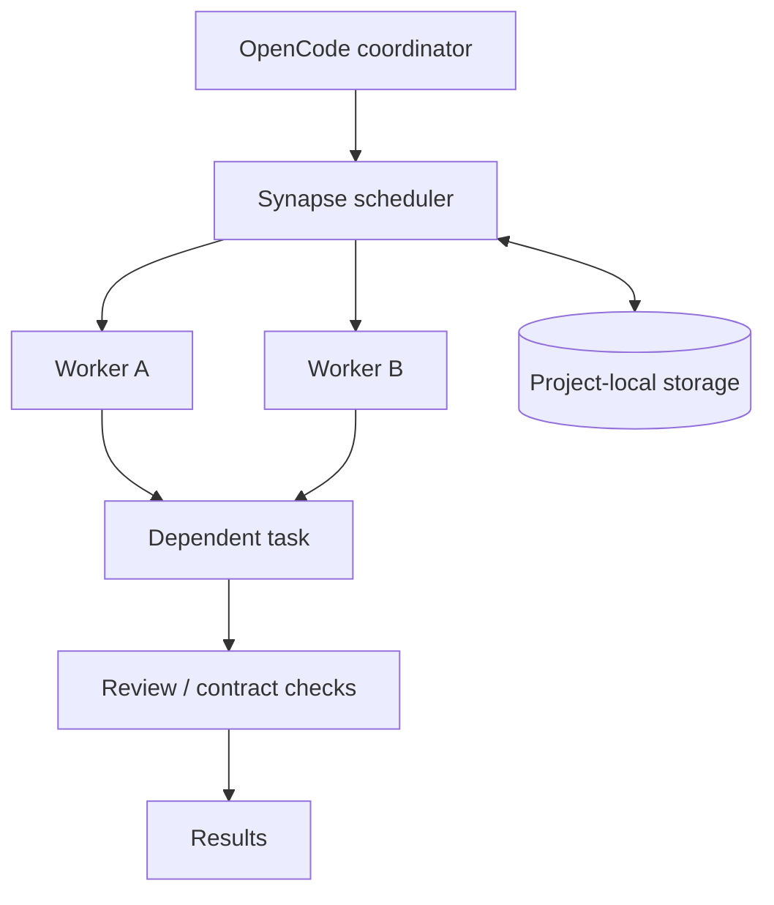

# Synapse

A collaborative agent runtime for [OpenCode](https://opencode.ai/).
[Français](README.fr.md)

Synapse is an OpenCode V2 plugin for work that benefits from more than one agent. It turns a plan into a dependency graph, runs independent tasks concurrently, and brings their results together in the main session. Workers can exchange messages, submit deliverables and request independent reviews. The history stays on your machine, scoped to the project.

The idea is simple: use multiple agents when they help, not just because they are available.

## What it does

- Runs task graphs with dependencies, bounded concurrency, retries and cancellation.
- Gives workers a shared message bus, explicit submission contracts and optional independent review.
- Keeps project-local run history and reviewed results in XDG storage.
- Records reported model usage and compares controlled experiments. Cost recommendations are advisory.
- Supports exact-output checks and a restricted tool profile for small, suitable tasks.
- Classifies provider failures, stops admitting new work in a graph after certain failures, and retains completed results.
- Produces local diagnostic reports and evidence-linked improvement proposals.

Workers are read-only by default. Reviewed patches can be staged manually in a separate worktree; Synapse does not automatically merge, deploy or rewrite itself.

## Getting started

**Requirements:** OpenCode V2, Node.js 22 or newer (a recent patch release), npm. Linux is the primary tested environment. The plugin uses the `@opencode/plugin` V2 SDK; actual host compatibility should be checked after installation.

### Install from a release (Linux)

Download the versioned source ZIP and matching Bash installer from the release assets. Finish active runs and close OpenCode first, then run the installer as your normal user, not root:

```sh
bash install-synapse-v1.0.0.sh Synapse-OpenCode-v1.0.0.zip
```

By default it installs to `~/Downloads/synapse-opencode`. An optional second argument specifies a different absolute installation path. Keep that path stable between upgrades. The installer backs up the old installation and configuration and checks plugin activation after restarting the service. Read [installation and rollback](docs/INSTALLATION.md) before upgrading.

### Install from source

Clone this repository (or extract its source archive) into a stable directory. From that directory:

```sh
npm install
npm test
npm run typecheck
npm run setup -- --global --dry-run
npm run setup -- --global
```

For a project-only installation, use `npm run setup -- --project /absolute/path/to/project` instead of `--global`. Both setup modes register the plugin and set the default agent to `synapse`; inspect the dry run first. The installer preserves the original JSONC in a backup, but comments are not retained in the rewritten file.

Restart OpenCode, open a new session in the target project, and ask the agent to call `synapse_version` and `synapse_doctor`. The health command checks the actual plugin source and activation status:

```sh
npm run health -- --project /absolute/path/to/project
```

### Try it without OpenCode

```sh
npm run demo
```

This runs a small graph with a mock adapter, two independent tasks, a dependent integration task and mock reviews. No provider credentials or model calls are needed.

## First run

In an OpenCode session using the Synapse agent, try:

> Plan a review of the architecture and test coverage of this repository. Run the two investigations independently, then combine their findings. Use independent reviews, keep the workers read-only, and show me the plan before executing anything.

Review the plan and authorize execution if appropriate. Use `synapse_status`, `synapse_trace` and `synapse_result` to inspect the outcome. There is a small plan example in [examples/team-plan.json](examples/team-plan.json).

## How it fits together



The core scheduler is independent of OpenCode. `src/opencode/` implements the session adapter, tool registration and hooks. `src/core/` contains the scheduler, storage, communication, validation, accounting and experimental analysis. Tests use mock adapters and temporary stores.

## Diagnostics and data

```sh
npm run doctor -- --project /absolute/path/to/project
npm run report -- --project /absolute/path/to/project
npm run monitor -- --project /absolute/path/to/project
```

Data normally lives under `${XDG_DATA_HOME:-$HOME/.local/share}/synapse/projects/`, keyed by the canonical project path. Do not commit runtime data, configuration backups or diagnostic ZIPs. Reports are designed to exclude sensitive content, but should still be inspected before sharing.

See the [documentation index](docs/README.md) for storage, contracts, experiments, usage accounting and troubleshooting.

## Current limitations

- One OpenCode writer per project is recommended. Cooperative disk locks protect individual graph and proposal operations; global resources and all logging are not synchronized across processes or hosts.
- Reviews are model judgments, not formal proof. OpenCode permissions are not an operating-system sandbox.
- Session budgets are not monetary spending caps. Reported usage is not a provider invoice. A smaller toolset does not by itself establish a billing reduction.
- Provider compatibility varies. The Lean profile's tool filtering has been observed on a real host, but a successful controlled generation comparison remains outstanding.
- The local v1.0.0 suite passes; the full SDK typecheck, fresh dependency audit and complex real-world validation remain release qualification tasks. See [validation notes](release/v1.0.0.md).
- Automatic model routing and cross-project memory sharing are not implemented.

## Development

```sh
npm test
npm run typecheck
npm run demo
```

See [CONTRIBUTING.md](CONTRIBUTING.md) for how to propose a change, [SECURITY.md](SECURITY.md) for security reports, and [CHANGELOG.md](CHANGELOG.md) for the release history.

Licensed under [MIT](LICENSE). Synapse is an independent project, not affiliated with OpenCode.
